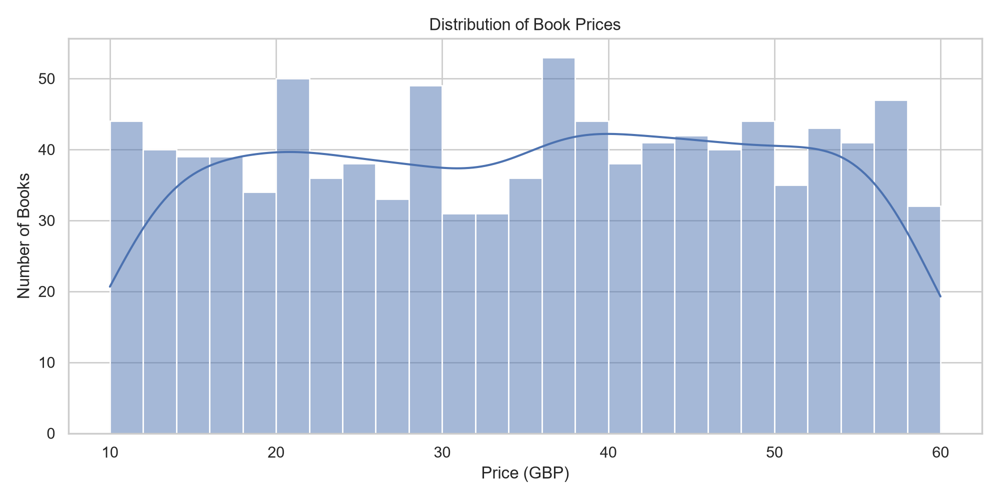
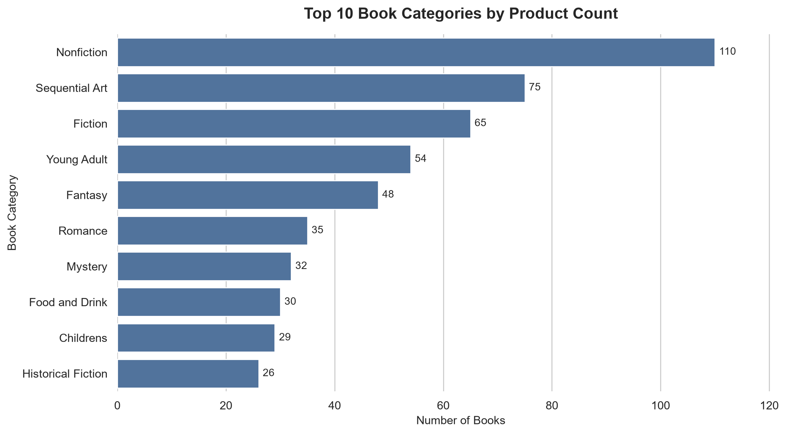
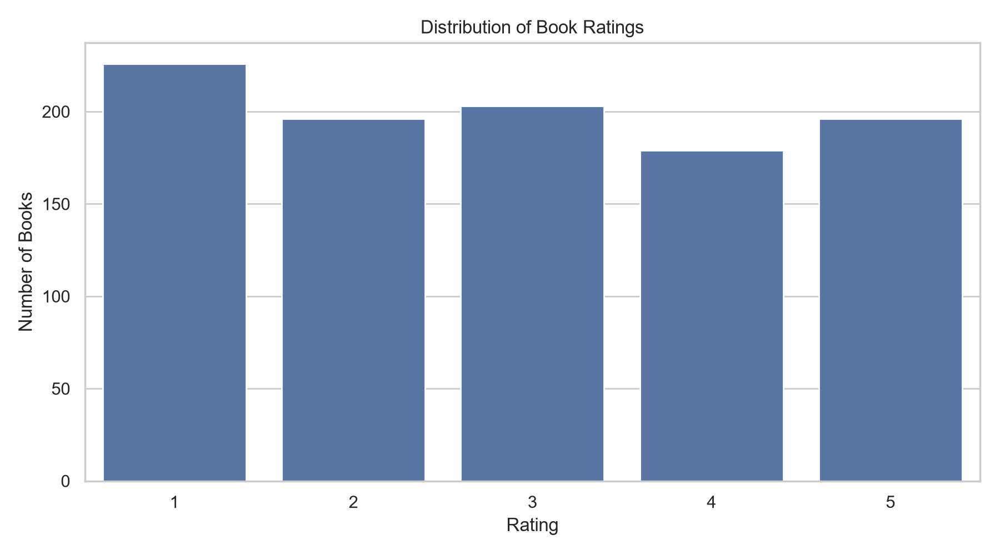
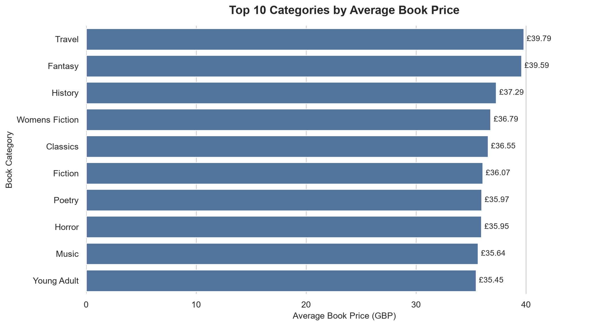
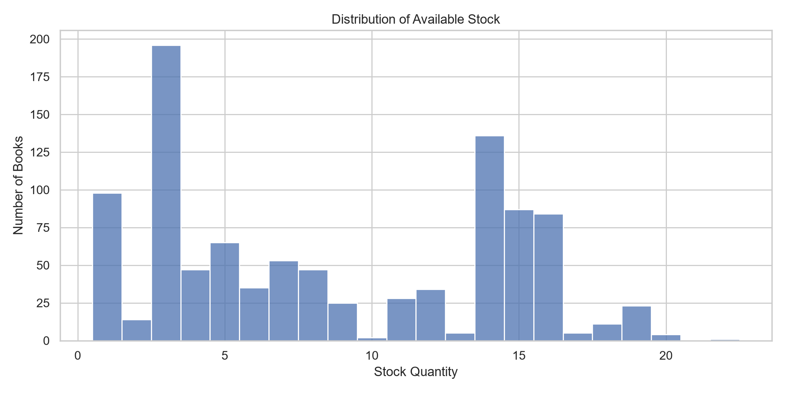

# Online Bookstore Data Extraction & Price Analysis

**A Python-based web scraping, data engineering, and exploratory data analysis project.**

An end-to-end pipeline that extracts, cleans, validates, and analyzes a complete online bookstore catalog using Python, Requests, BeautifulSoup, Pandas, and Seaborn.

**Project Type:** Web Scraping & Data Analysis  
**Dataset:** 1,000 books across 50 catalog pages  
**Data Source:** [Books to Scrape](https://books.toscrape.com/)  
**Tools:** Python · Requests · BeautifulSoup · Pandas · Matplotlib · Seaborn · Pytest · Excel

> **Disclaimer:** This project uses Books to Scrape, a website designed for practicing web scraping. Prices and ratings are simulated. The business scenario is hypothetical; this project does not represent an actual client engagement or real competitor market intelligence.

---

## 1. Project Overview

This project demonstrates how unstructured product information from a multi-page e-commerce catalog can be transformed into a structured, validated, and analysis-ready dataset.

The solution includes:

- Automated catalog pagination and product discovery
- Product-level detail extraction
- Data cleaning and duplicate detection
- Automated data quality validation
- CSV, Excel, and JSON exports
- Exploratory data analysis and visualizations
- Logging, error handling, retries, and automated parser tests

The final pipeline successfully extracted **1,000 unique book records from 50 catalog pages**, with no failed product requests.

## 2. Business Problem

In a simulated retail research scenario, a business analyst needs to collect and examine product catalog information, including pricing, categories, ratings, and inventory availability.

Manually collecting information across hundreds of product pages is repetitive, time-consuming, and prone to inconsistencies.

This project addresses that challenge by building a reusable Python pipeline that converts website content into structured datasets suitable for analysis and reporting.

### Project Objectives

1. Extract all publicly accessible books from the practice catalog.
2. Collect product details, including titles, categories, prices, ratings, and stock quantities.
3. Clean and standardize extracted information.
4. Validate dataset completeness, uniqueness, and consistency.
5. Analyze product distribution, pricing, ratings, and inventory.
6. Deliver reproducible code, datasets, reports, and visualizations.

## 3. Technology Stack

| Technology | Purpose |
|---|---|
| Python | Core programming language |
| Requests | HTTP requests and page retrieval |
| BeautifulSoup | HTML parsing and product extraction |
| Pandas | Data cleaning, transformation, and analysis |
| Matplotlib | Data visualization |
| Seaborn | Statistical and categorical charts |
| OpenPyXL | Excel export |
| Pytest | Automated parser testing |
| Git & GitHub | Version control and project documentation |
| Jupyter Notebook | Exploratory data analysis |

## 4. Project Structure

```text
Bookstore_Data_Extraction/
├── config/
│   ├── __init__.py
│   └── settings.py
├── src/
│   ├── __init__.py
│   ├── scraper.py
│   ├── parser.py
│   ├── cleaner.py
│   └── validator.py
├── data/
│   ├── raw/
│   │   ├── books_raw.json
│   │   └── failed_urls.json
│   └── processed/
│       ├── books_cleaned.csv
│       ├── books_cleaned.xlsx
│       └── validation_report.json
├── notebooks/
│   └── bookstore_analysis.ipynb
├── outputs/
│   ├── charts/
│   │   ├── 01_price_distribution.png
│   │   ├── 02_top_categories.png
│   │   ├── 03_rating_distribution.png
│   │   ├── 04_category_average_prices.png
│   │   └── 05_stock_distribution.png
│   └── reports/
│       └── analysis_summary.csv
├── tests/
│   └── test_parser.py
├── logs/
├── main.py
├── requirements.txt
├── .gitignore
└── README.md
```

## 5. Data Collection Methodology

### Step 1 — Catalog Discovery

The scraper visits the bookstore catalog and follows pagination links to discover individual product URLs.

**Extraction coverage:**
- Catalog pages processed: 50
- Unique product URLs discovered: 1,000
- Failed product requests: 0

### Step 2 — Product Detail Extraction

The scraper visits individual product pages and extracts structured information.

The dataset contains the following 12 fields:

| Column | Description |
|---|---|
| `upc` | Unique product identifier |
| `title` | Book title |
| `category` | Book category |
| `price_gbp` | Listed price in GBP |
| `rating` | Simulated star rating from 1 to 5 |
| `availability` | Product availability text |
| `stock_quantity` | Listed available stock units |
| `review_count` | Number of recorded reviews |
| `description` | Product description, when available |
| `product_url` | Full product page URL |
| `image_url` | Full product image URL |
| `scraped_at_utc` | Extraction timestamp |

### Step 3 — Data Cleaning

Extracted information is processed with Pandas to produce consistent, analysis-ready data.

Cleaning operations include:

- Standardizing price values as numeric GBP amounts
- Converting rating labels into numeric values
- Extracting stock quantities
- Removing duplicate product records
- Preserving missing optional descriptions as missing values
- Preparing structured CSV and Excel outputs

### Step 4 — Data Validation

Automated checks verify dataset integrity and identify data quality issues.

**Final validation results:**

| Validation Metric | Result |
|---|---:|
| Total records | 1,000 |
| Unique product URLs | 1,000 |
| Duplicate UPCs | 0 |
| Failed product requests | 0 |
| Missing mandatory fields | 0 |
| Missing optional descriptions | 2 |
| Validation status | Passed |

The original dataset retains all 1,000 products.

## 6. Exploratory Data Analysis

The cleaned dataset was analyzed using Pandas, Matplotlib, and Seaborn.

### Dataset Summary

| Metric | Result |
|---|---:|
| Total books | 1,000 |
| Total categories | 50 |
| Average book price | £35.07 |
| Median book price | £35.98 |
| Minimum price | £10.00 |
| Maximum price | £59.99 |
| Average simulated rating | 2.92 / 5 |
| Total listed stock units | 8,585 |
| Missing descriptions | 2 |

### 6.1 Book Price Distribution



Book prices range from £10.00 to £59.99, with an average of £35.07.

The distribution provides an overview of the pricing structure within the simulated catalog.

### 6.2 Top 10 Book Categories



The most populated descriptive categories include:

| Category | Book Count |
|---|---:|
| Nonfiction | 110 |
| Sequential Art | 75 |
| Fiction | 65 |
| Young Adult | 54 |
| Fantasy | 48 |

**Data preparation note:** The website includes the non-descriptive category labels `Default` and `Add a comment`. These were excluded from category-focused charts only.

- Books included in category-focused analysis: 781
- Books excluded from category-focused analysis: 219
- Original dataset retained: 1,000 books

### 6.3 Book Rating Distribution



The average simulated rating is approximately 2.92 out of 5.

Ratings are displayed to demonstrate categorical data analysis, not to infer real customer satisfaction.

### 6.4 Average Book Price by Category



The highest average prices among eligible categories were:

| Category | Average Price |
|---|---:|
| Travel | £39.79 |
| Fantasy | £39.59 |
| History | £37.29 |
| Womens Fiction | £36.79 |
| Classics | £36.55 |

This analysis includes only categories containing at least 10 books and excludes the two non-descriptive category labels.

### 6.5 Stock Quantity Distribution



The catalog contains 8,585 listed stock units, with an average of approximately 8.59 units per book.

The visualization highlights variation in the simulated inventory quantities.

## 7. Key Findings

1. **Successful automated extraction:** The pipeline collected 1,000 unique product records across 50 catalog pages without failed product requests.

2. **Strong data completeness:** All required dataset fields were populated, while only two optional product descriptions were missing.

3. **Catalog composition:** Nonfiction is the largest descriptive category, with 110 books, followed by Sequential Art with 75 and Fiction with 65.

4. **Price characteristics:** The average listed book price is £35.07, with values ranging from £10.00 to £59.99.

5. **Category-level price comparison:** Travel has the highest average listed price (£39.79) among the eligible categories included in the analysis.

6. **Inventory overview:** The sample catalog contains 8,585 listed stock units.

7. **Taxonomy quality:** Non-descriptive labels account for 219 books, demonstrating why category cleaning and transparent analytical filtering matter.

These findings describe the practice dataset only and should not be generalized to real retail markets.

## 8. How to Run the Project

### Prerequisites

- Python 3.10 or later
- Internet connection
- Git (optional)
- VS Code or another Python development environment

### Step 1 — Clone the Repository

```bash
git clone <YOUR_REPOSITORY_URL>
cd Bookstore_Data_Extraction
```

Replace `<YOUR_REPOSITORY_URL>` with the actual GitHub repository URL after publishing.

### Step 2 — Install Dependencies

```bash
python -m pip install -r requirements.txt
```

### Step 3 — Run Automated Tests

```bash
python -m pytest -q
```

### Step 4 — Configure Extraction

Open `config/settings.py`.

For a limited test:

```python
MAX_PAGES = 2
```

For the complete catalog:

```python
MAX_PAGES = None
```

Before running, review the target website's access rules, robots.txt, and terms.

### Step 5 — Run the Scraper

```bash
python main.py
```

The scraper uses controlled request delays, timeouts, retry handling, and logging.

### Step 6 — Explore the Analysis

Open:

```text
notebooks/bookstore_analysis.ipynb
```

Run the notebook cells to reproduce the visualizations and summary report.

## 9. Project Deliverables

The project produces:

- Raw product data in JSON format
- Cleaned dataset in CSV and Excel formats
- Data validation report
- Five exploratory data analysis charts
- Analysis summary report
- Jupyter Notebook containing reproducible analysis
- Modular Python source code
- Automated parser tests
- Execution logs

## 10. Limitations and Ethical Considerations

- The data source is an educational web scraping practice website.
- Product prices and ratings are simulated.
- Inventory values represent a single catalog snapshot.
- No historical pricing or stock trends can be inferred.
- Review counts are zero across the extracted catalog, limiting review-based analysis.
- Non-descriptive categories were excluded from selected visualizations, not removed from the original dataset.
- Website structures may change and require updates to HTML selectors.
- The scraper should be run responsibly, respecting site rules and request-rate limits.

## 11. Skills Demonstrated

**Web Scraping:** HTTP requests, HTML parsing, CSS selectors, pagination, product detail extraction.

**Data Engineering:** Structured data extraction, data cleaning, validation, CSV/Excel/JSON export.

**Data Analysis:** Descriptive statistics, category comparisons, pricing analysis, inventory analysis.

**Visualization:** Matplotlib, Seaborn, business-oriented reporting.

**Software Engineering:** Modular project structure, exception handling, logging, automated tests, reproducibility.

## 12. Project Status

**Completed:** Full extraction, data cleaning, validation, exploratory data analysis, and visualization.

**Next:** GitHub publication and portfolio integration.

---

**Developed by Muhammad Hassan**  
*Data Analyst | Python Web Scraping | SQL | Power BI | Excel*

**Portfolio:** [hassandataanalyst.github.io/Portfolio](https://hassandataanalyst.github.io/Portfolio)

**Data Source:** [Books to Scrape](https://books.toscrape.com/)

